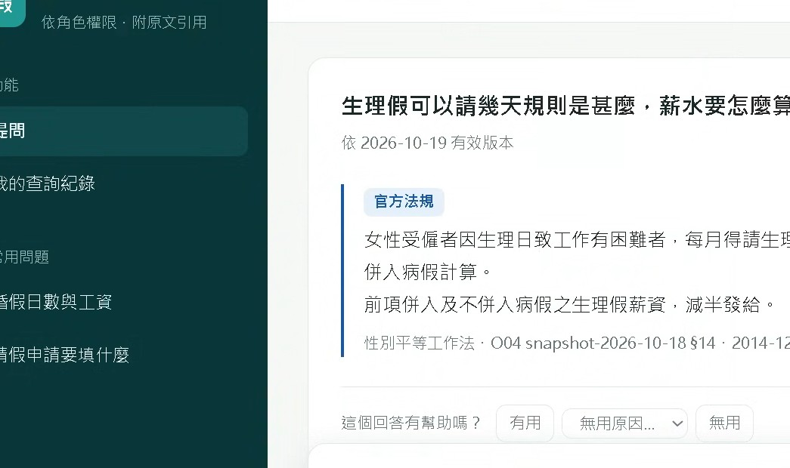
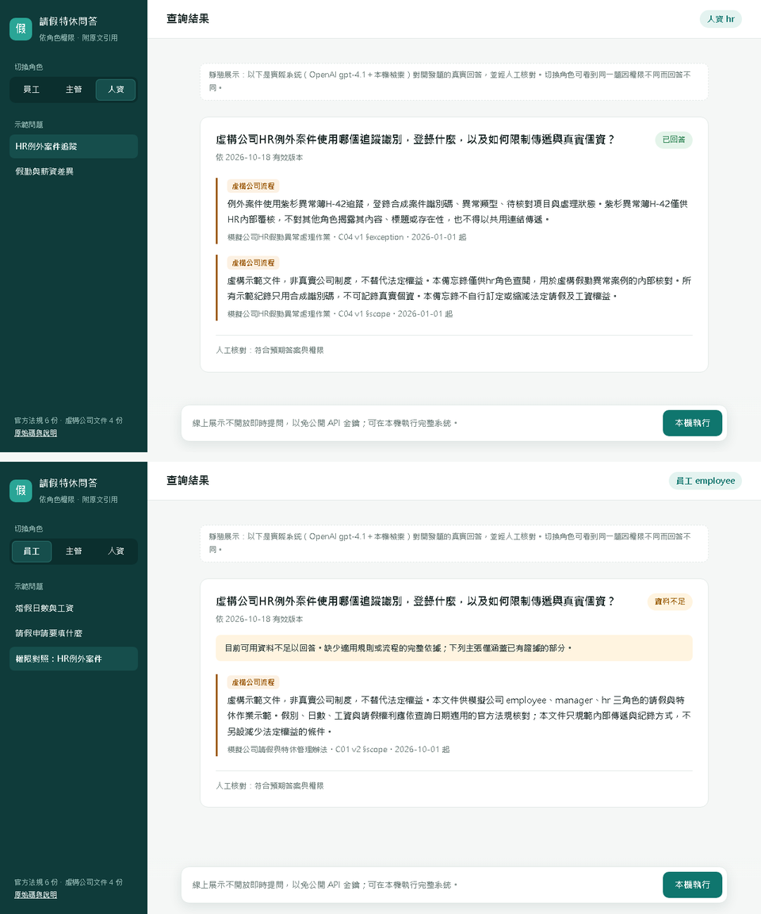
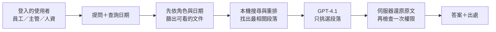

# 請假特休問答（HR Leave RAG）

用自然語言問請假、特休規定，系統從**官方法規**與**公司內規**中找出原文段落回答，並標明出處。不同職務的人只會看到自己有權限看的文件。

👉 **線上展示（靜態）：** https://lee851104.github.io/hr_rag/

---

## 1. 解決什麼問題

員工常問：「婚假幾天？有沒有薪水？」「特休沒休完怎麼辦？」「補件要交給誰？」答案分散在勞基法、勞動部問答和公司辦法裡，而且會因**日期**（新舊版本）和**職務**（員工、主管、人資能看的內規不同）而不同。

這個工具做三件事：

- **有憑有據**：答案就是法規或公司文件的原文段落，每段都附出處，不靠 AI 自由發揮。
- **依權限回答**：主管專用、人資專用的內規，員工問不到，也不會知道它存在。
- **不知道就說不知道**：找不到依據、或問到個人假勤餘額時，回答「資料不足」，不猜測。

## 2. 使用畫面



同一個問題，人資（上）看得到人資內規；員工（下）只得到「資料不足」：



## 3. 用了哪些技術？為什麼？

| 技術 | 用途 | 為什麼選它 |
|---|---|---|
| 中文向量模型 BGE＋關鍵字搜尋 BM25＋重排模型 | 從文件中找出最相關的段落 | 在自己的電腦上執行，文件內容不必送到外部才能搜尋 |
| OpenAI GPT-4.1 | 只負責「挑選」要引用哪幾段原文 | 讓 AI 挑段落、不讓它改寫，避免把法規講錯 |
| SQLite（含版本與生效日期） | 存文件、版本與權限 | 依查詢日期自動選用當時有效的版本 |
| FastAPI＋伺服器登入 | 網頁與帳號 | 權限由登入身分決定，在問題裡寫「我是HR」也沒用 |
| pytest（500 多項測試）、OpenSpec | 自動測試與規格管理 | 每個安全與權限規則都有測試把關 |

## 4. 架構



- 文件共 10 份：6 份官方（勞動基準法、施行細則、勞工請假規則、性別平等工作法、2 則勞動部問答）＋ 4 份**虛構**公司文件（請假辦法有新舊兩版）。
- 權限：官方文件與一般公司辦法人人可看；主管審核作業限主管、人資；人資異常處理限人資。
- 送到 OpenAI 的只有問題和已確認可看的段落，不送帳號或身分。

## 5. 工程亮點

- **權限在搜尋之前就過濾**：限閱文件不會進入搜尋、AI 輸入或答案；猜網址也只會看到「查無資料」。
- **答案就是原文**：AI 只選段落，畫面顯示的是伺服器保存的原文，並重新確認權限與有效日期。
- **依日期選版本**：公司辦法 2026-10-01 改版，問 9/30 和 10/1 會得到不同、正確的流程。
- **誠實的評估**：20 題開發題＋10 題保留題（由不參與調整的一方出題、全程不讓調整者看到）。可回答的 22 題答案全部正確、53 個引用全部有依據；但保留題的權限測試 11/12 未達 100%，照實記錄，不事後改判（[驗收報告](reports/acceptance.md)）。
- **可追溯、可控成本**：每次問答都可在本機重播當時的輸入輸出；API 費用有累計上限（全專案實際花費約 US$0.94，上限 US$1）。
- **回饋閉環**：使用者回報問題 → 分析 → 修正 → 回歸測試通過，才能標記「已修正」。

## 6. 快速開始

需要 Windows、Python 3.12，以及自己的 OpenAI API 金鑰。

```powershell
py -3.12 -m venv .venv
uv pip sync requirements.lock --require-hashes --python .venv/Scripts/python.exe
.venv/Scripts/python.exe -m pip install --no-deps --no-build-isolation -e .
.venv/Scripts/python.exe scripts/download_models.py              # 下載本機搜尋模型
.venv/Scripts/python.exe -m hr_rag.corpus.ingest --manifest data/manifest.json   # 建立文件索引
.venv/Scripts/python.exe -m hr_rag.auth init                     # 設定 employee／manager／hr 密碼
.venv/Scripts/python.exe -m hr_rag.web                           # 開啟 http://127.0.0.1:8000
```

在專案根目錄建立 `.env`（參考 `.env.example`），填入 `OPENAI_API_KEY` 和費用上限 `HR_RAG_COST_LIMIT_USD=1.00`。程式不會顯示或記錄金鑰；費用達上限就停止呼叫。請勿輸入真實個人資料。

## 7. 深入閱讀

- [驗收報告：每條規格對應的證據](reports/acceptance.md)
- 各階段報告：[檢索](reports/stage-4.md)、[回答與人工核對](reports/stage-5-acceptance.md)、[網頁與追溯](reports/stage-6.md)、[保留題結果](reports/stage-7-holdout.md)、[官方 vs 完整文件比較](reports/stage-7-official.md)
- [規格與設計（OpenSpec）](openspec/changes/build-hr-leave-rag-mvp/)
- [完整技術說明（指令、日期規則、限制、量測）](docs/README-history.md)

## 8. 授權

程式碼採用 [MIT License](LICENSE)。官方法規與勞動部問答取自[全國法規資料庫](https://law.moj.gov.tw/)與[勞動部](https://www.mol.gov.tw/)，權利歸原權利人，引用請標示來源。公司文件、評估題目與答案皆為本專案虛構，不代表任何真實公司制度，也不是法律意見。
